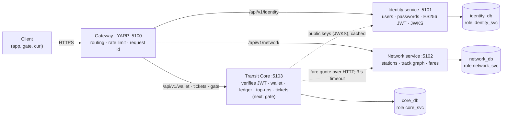
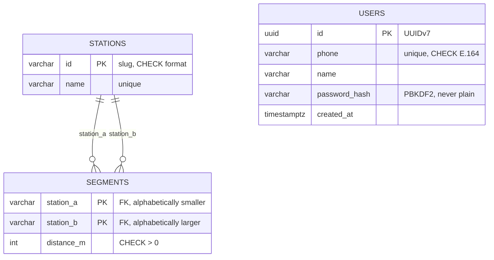
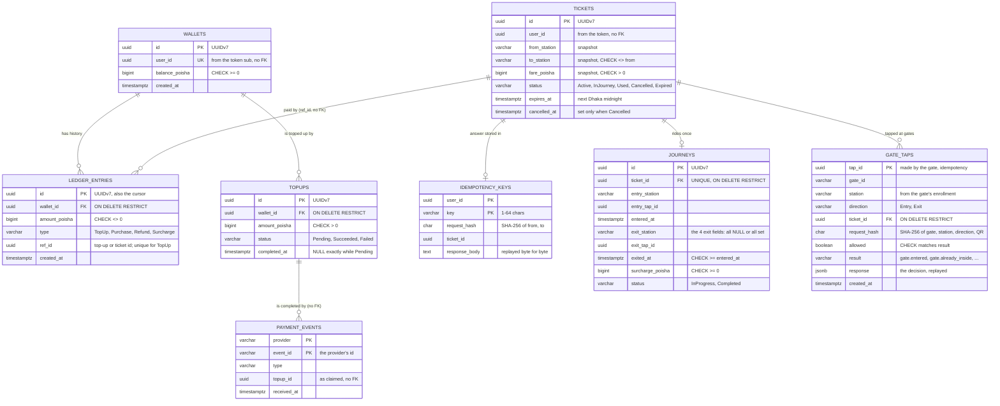

<h1 align="center">🚇 TransitPass</h1>
<p align="center"><em>Cashless metro ticketing for Dhaka. Tap in, ride, tap out. No double spend, no copied QR, no lost money.</em></p>

<p align="center">
  <a href="https://github.com/istiak133/transit-pass/actions/workflows/ci.yml"></a>
  
  
  
  
  
  
  
</p>

---

A metro ticketing backend built around one passenger, **Rafi**: he signs up, tops up his wallet, buys a ticket from **Uttara North** to **Motijheel**, taps in at the gate, rides, and taps out.

- 🏗️ **Architecture:** four .NET 10 services behind a YARP API gateway, each with its own PostgreSQL database
- ✅ **Built so far:** the platform (gateway, rate limiting, errors, health, CI), stations, the track graph with fare quotes (Dijkstra), sign-up, login with ES256-signed JWTs, and the first protected endpoint, which Core verifies locally with Identity's public keys
- 🛣️ **In progress:** signed QR, gates (see [Roadmap](#-roadmap))
- 🧪 **Quality:** 237 tests, database tests against a real PostgreSQL 17 (Testcontainers), and CI with CodeQL on every pull request
- 📚 **Decisions:** 19 [Architecture Decision Records](docs/adr/README.md) and a [PRD](docs/PRD.md)

---

## 📑 Contents

[Problem](#-problem-statement) · [Features](#-features-implemented) · [Architecture](#-architecture) · [Data model](#️-data-model) · [Tech stack](#-tech-stack) · [Project structure](#-project-structure) · [Setup](#-setup) · [Tests](#-tests) · [API](#-api-overview) · [Fares](#-fare-model) · [Concurrency](#-concurrency) · [Security](#️-security-basics) · [Decisions](#-key-decisions-and-trade-offs) · [Limitations](#-known-limitations) · [Roadmap](#-roadmap) · [How it's built](#-how-its-built)

---

## 🎯 Problem statement

TransitPass started from studying an open-source student metro ticketing project. It works in a demo, but it breaks as soon as real money, real concurrency or a dishonest user shows up:

- 💸 **Double spend:** two purchases at the same instant both read a ৳100 balance and both succeed.
- 🔁 **Payment replay:** top-ups were credited from the browser's "success" redirect, which anyone can repeat or fake.
- 🚪 **Open scanner:** the gate API had no device authentication, so any client could mark tickets as used.
- 📸 **Static QR:** a screenshot shared on WhatsApp let several people ride on one ticket.
- 📴 **No offline mode:** gates without internet stopped everyone.
- 🧍 **Stuck passengers:** a missed exit tap left a journey open forever.
- 🧮 **Float money and mutable balances:** rounding errors, and no record of where money came from.
- 🧪 **No tests, broken CI:** nothing proved any of it worked.

**The goal:** make each of these failures impossible by design, and prove it with tests.

## ✨ Features implemented

**🌐 Platform (all services)**
- One entry point: a **YARP** gateway routes `/api/v1/{identity|network|wallet|tickets|gate}/…` to the right service
- **Rate limiting** per client IP (token bucket: burst 100, refill 50/s); excess requests get `429` with `Retry-After`
- Every error is an **RFC 9457 problem** with a stable machine-readable `code` and a `traceId`
- `X-Request-Id` on every request: accepted only if it is a UUID, otherwise a new one is made (no log injection)
- `/health/live` (process up) and `/health/ready` (database answers `SELECT 1`, else `503`)
- Cursor (keyset) pagination primitives, ready for history screens

**🗺️ Network service**
- Station list and lookup, stored in PostgreSQL through EF Core
- The **track graph**: one row per stretch of track, with its length in metres
- **Fare quotes:** shortest distance by **Dijkstra**, precomputed for every pair of stations at first use, then priced by distance slab

**🔐 Identity service**
- **Sign-up** with a Bangladeshi mobile number, a name and a password
- Phone numbers are **normalized to E.164**: `01711000001`, `8801711000001` and `+880 1711-000001` are one phone, so one account
- Passwords hashed with **PBKDF2-HMAC-SHA256**, 600,000 iterations and a random salt per user, never stored or returned
- **One phone, one account,** even when sign-ups race (tested with 10 at once)
- **Login** returns a 15-minute **ES256-signed JWT** (`sub`, `iss`, `aud`, `iat`, `exp`, `jti`; no personal data inside)
- **`/.well-known/jwks.json`** publishes the public key with a `kid` (RFC 7638 thumbprint), so other services can verify tokens without calling Identity and without the private key
- **One answer for every failed login:** unknown phone, wrong password or a malformed phone all get the same `401`, and take the same time (a dummy PBKDF2 check runs when the phone has no account)
- **At most 5 login attempts per minute per phone,** across formats and IPs (`429` with `Retry-After`)

**🎫 Transit Core service**
- `GET /api/v1/wallet/me` is the first **protected endpoint**: `401` without a valid token, and the caller's id taken from the token's `sub` (never from the URL or the body)
- Tokens are **verified locally**: Core fetches Identity's public keys from JWKS **once**, caches them, refreshes every 10 minutes, and re-fetches early when a token names an unknown `kid` (key rotation)
- **Only ES256** is accepted, so `alg: none` and HS256 tokens are refused. Issuer, audience and expiry are checked, with 30 s of clock skew
- **Resilient and abuse-proof:** if Identity is down, cached keys keep working; a flood of tokens with fake `kid`s can't turn into a flood of requests to Identity (at most one forced refresh every 30 s)
- The same verification lives in BuildingBlocks (`AddJwtAuthentication`), so any service can protect its endpoints with one call
- **Wallet on first visit:** `GET /api/v1/wallet/me` finds or creates the caller's wallet (`INSERT … ON CONFLICT DO NOTHING` on `UNIQUE(user_id)`, so 20 simultaneous first visits still make one wallet) and returns the balance in **integer poisha**
- **Append-only ledger:** every taka that moves is a `ledger_entries` row (`TopUp`, `Purchase`, `Refund`, `Surcharge`), never edited or deleted. The balance is a cache of `SUM(amount)`, and both change in **one transaction**
- **No overspending, even under races:** a posting is one conditional `UPDATE … SET balance = balance + amount WHERE balance + amount >= 0`, and `CHECK (balance_poisha >= 0)` backs it up in the database (20 racing ৳100 debits on ৳1000 → exactly 10 succeed)
- **History with keyset pagination:** `GET /api/v1/wallet/me/transactions?after=&limit=` returns newest first, served by an index scan on `(wallet_id, id)` in O(log n + page) at any depth
- **Top-up, credited only by the provider:** `POST /api/v1/wallet/topups` creates a `Pending` top-up (৳10 to ৳50,000) and a checkout URL. No money moves until the payment provider's **HMAC-SHA256-signed webhook** arrives, because a browser saying "paid" proves nothing
- **Webhook signature:** `Payment-Signature: t=<unix>,v1=<hex>` over `"{t}." + the raw body bytes`, compared with `FixedTimeEquals`; a timestamp older than 5 minutes is refused (replays), and the body is never parsed before the signature checks out
- **Credited once, whatever arrives:** three guards in one transaction. An **inbox** (`payment_events`, PK `(provider, event_id)`, `INSERT … ON CONFLICT DO NOTHING`) drops re-deliveries; a **state machine** (`UPDATE … WHERE status = 'Pending'`) drops a second event for a finished top-up; a **partial unique index** (`ref_id WHERE type = 'TopUp'`) allows one credit row per top-up even if code skips the first two
- `deploy/fake-payment.sh` plays the provider locally: it signs and sends the webhook with the secret from `.env`
- **Buying a ticket:** `POST /api/v1/tickets { from, to }` asks the **Network service for the fare over HTTP** (3 s timeout, outside any database transaction), then in **one transaction** claims the `Idempotency-Key`, debits the wallet through the ledger and inserts the ticket. Stations and fare are copied onto the ticket (a snapshot), and it's valid until midnight in Dhaka
- **Exactly once per `Idempotency-Key`:** a retry gets the original `201` back, byte for byte, with `Idempotent-Replayed: true`, and no second charge or Network call. The same key for a different trip is `422`. Keys are per user, and a failed attempt stores nothing, so the key can be reused after a top-up
- **Proven under load:** 200 simultaneous purchases with money for 10 → exactly 10 tickets, balance 0; 50 simultaneous retries of one key → one ticket
- **Network trouble is not the user's fault:** Network's own answers pass through (`404 station.not_found`, `400 fare.same_station`, `422 fare.no_route`); down, 5xx, a timeout or garbage become `503 network.unavailable`. None of them move money
- **My tickets:** `GET /api/v1/tickets?after=&limit=` pages newest first with the same keyset cursor as the wallet history, on `ix_tickets_user_id_id`
- **Cancel with refund:** `POST /api/v1/tickets/{id}/cancel` moves the ticket with one guarded update (`WHERE status = 'Active' AND expires_at > now`) and credits the fare back as a new `Refund` ledger row (a reversal; the purchase row is never edited), in one transaction. Cancelling again returns the same `200` with no second refund; a ticket already scanned, used or past its service day → `409`
- **Signed QR credential:** `GET /api/v1/tickets/{id}/credential` returns a compact **JWS signed with ES256 by Core's own QR key** (not Identity's): `tid`, `sub`, `from`, `to`, `iat`, and `exp` = the ticket's own expiry. The app shows it as a QR code; `Cache-Control: no-store`
- **Gates verify offline:** `GET /api/v1/gate/.well-known/jwks.json` publishes the QR public key(s) with a `kid`. `TicketCredentialVerifier` checks a QR with **public keys only**: ES256 pinned, `kid` must match, `typ` must be `transitpass-ticket+jwt`, issuer `transitpass-core`, audience `transitpass-gate`, `exp` with 30 s of clock skew
- **A login token is never a ticket, and a ticket is never a login:** different key, `typ`, issuer and audience, each enough on its own
- **Only usable tickets get a QR:** `Active` (to enter) or `InJourney` (to exit) → `200`; `Cancelled`, `Used`, `Expired` → `409 ticket.not_usable`; still `Active` but past its service day → `409 ticket.expired`; someone else's → `404`
- **Key rotation:** retired public keys (`Qr__RetiredPublicKeyPems__N`) stay in the JWKS and keep verifying old QR codes by `kid` until they expire
- **Gates:** `POST /api/v1/gate/taps { tapId, gateId, stationId, direction, credential }` is called by **gate devices, not users**. Each gate has its own random key (`X-Gate-Key`); Core is configured with only its **SHA-256**, and the gate's station comes from its enrollment (a gate claiming another station → `403 gate.wrong_station`)
- **Entry:** verify the QR with public keys → the station exists (Network) → one transaction: guarded `UPDATE tickets SET status = 'InJourney' WHERE status = 'Active' AND expires_at > now`, then a `journeys` row. **Any station** may be the entry; the exit prices the trip actually made
- **Exit:** fare from the **entry station to the exit station** (Network, outside the transaction). More than the ticket's fare → the difference is charged as a `Surcharge` ledger row; a shorter trip gets no refund. One transaction: ticket `InJourney → Used`, journey `Completed`, wallet debit, always locked in the order **ticket → journey → wallet**
- **Can't pay the extra → `422 gate.insufficient_funds`**, the gate stays closed and the ticket stays `InJourney`; after a top-up the next tap opens it. Someone inside at midnight can still leave: exits accept a QR up to 3 h past its expiry (`Gate__ExitGracePeriod`)
- **Every tap is idempotent:** the gate makes a `tapId` per physical tap; the decision (open or refused) is stored in `gate_taps` and a resent `tapId` gets the same answer with `Idempotent-Replayed: true`. The same `tapId` for a different tap → `422 gate.tap_reused`
- **Expired tickets refund themselves:** a background job in Core (every minute, `Jobs__ExpiryInterval`) finds `Active` tickets past their service day on the partial index `ix_tickets_active_expiry`, marks them `Expired` and credits the full fare back as a `Refund` ledger row. Batches of 100 in one transaction each, locked with `FOR UPDATE SKIP LOCKED`, so **every Core replica can run it** with no leader: each takes different tickets, and a ticket is refunded once (guarded `UPDATE … WHERE status = 'Active'` + one `Refund` row per ticket). One bad row is rolled back alone (a savepoint) and retried next run; the rest of the batch goes on. `Jobs__ExpiryEnabled=false` turns it off
- **One QR, one ride:** 20 taps of the same QR at four gates at once → one entry; two exits at once → one exit and one surcharge; entry racing a cancel → exactly one winner. `deploy/gate-tap.sh` plays a gate locally

**🛠️ Engineering**
- Database-per-service: each service logs in as its own PostgreSQL role, and the others cannot even connect
- One-command local run with Docker Compose. Images are multi-stage and run as a non-root user
- EF Core migrations per service. The database refuses bad data by itself through CHECK, UNIQUE and FOREIGN KEY constraints

## 📐 Architecture



- 🧱 **Four processes, three databases.** Each service owns its data, and no service reads another's tables.
- 💰 **Why wallet, tickets and gates share one service (Transit Core):** buying a ticket must take the money, record it in the ledger and create the ticket **all together or not at all**. Inside one database that is a single ACID transaction. Split across services, it would need sagas and compensations, for no benefit at this size. See [ADR 0019](docs/adr/0019-microservices-with-transit-core.md).
- 🔗 **Across services there are no foreign keys.** Core will store `user_id` taken from a verified token, and copy the stations and fare into the ticket at purchase (a snapshot), so a later price change never alters an old ticket or its refund.

### 🔁 One request, end to end

`GET /api/v1/network/fares/quote?from=uttara-north&to=motijheel`

1. **Gateway:** checks the client's rate-limit bucket, adds an `X-Request-Id`, and forwards to Network
2. **Network:** on first use, `FareCatalog` loads stations and segments from `network_db` once, and runs Dijkstra from every station
3. **Lookup:** two dictionary reads plus one array read give 16,500 m
4. **Price:** a binary search over the fare slabs gives ৳100
5. **Response:** `{"from":"uttara-north","to":"motijheel","distanceM":16500,"farePoisha":10000}`

## 🗄️ Data model





`users` lives in `identity_db`. `stations` and `segments` live in `network_db`. `wallets`, `ledger_entries`, `topups`, `payment_events`, `tickets`, `idempotency_keys`, `journeys` and `gate_taps` live in `core_db`; `wallets.user_id` holds an Identity user id with no FK, because that table is in another database.

### 📋 Tables

| Table | Database | What it holds | Keys, constraints and indexes |
|---|---|---|---|
| `users` | identity_db | One row per passenger: phone, name, password hash | `pk_users (id)` · `ux_users_phone` unique · `ck_users_phone_e164` CHECK `^\+[1-9][0-9]{7,14}$` |
| `stations` | network_db | The stations, with readable ids like `agargaon` | `pk_stations (id)` · `ux_stations_name` unique · `ck_stations_id_slug` CHECK |
| `segments` | network_db | One row per stretch of track and its length | `pk_segments (station_a, station_b)` · 2 FKs → `stations` with `ON DELETE RESTRICT` · `ck_segments_canonical_order` CHECK `station_a < station_b` (byte collation) · `ck_segments_distance_positive` · `ix_segments_station_b` |
| `wallets` | core_db | One wallet per user and its current balance (a cache of the ledger sum) | `pk_wallets (id)` · `ux_wallets_user_id` unique · `ck_wallets_balance_non_negative` CHECK `balance_poisha >= 0` |
| `ledger_entries` | core_db | Every movement of money, append-only | `pk_ledger_entries (id)` · `fk_ledger_entries_wallet` → `wallets` `ON DELETE RESTRICT` · `ck_ledger_entries_amount_non_zero` · `ck_ledger_entries_type` · `ix_ledger_entries_wallet_id_id (wallet_id, id)` · `ux_ledger_entries_topup_ref` partial unique `(ref_id) WHERE type = 'TopUp'` · `ux_ledger_entries_refund_ref` partial unique `(ref_id) WHERE type = 'Refund'` · `ux_ledger_entries_surcharge_ref` partial unique `(ref_id) WHERE type = 'Surcharge'` |
| `topups` | core_db | A request to add money and its state | `pk_topups (id)` · `fk_topups_wallet` RESTRICT · `ck_topups_amount_positive` · `ck_topups_status` · `ck_topups_completed_at` CHECK `(status = 'Pending') = (completed_at IS NULL)` · `ix_topups_wallet_id_id` |
| `payment_events` | core_db | The inbox: every provider notification already processed | `pk_payment_events (provider, event_id)` |
| `tickets` | core_db | Every ticket, with stations and fare copied at purchase | `pk_tickets (id)` · `ck_tickets_different_stations` · `ck_tickets_fare_positive` · `ck_tickets_status` · `ck_tickets_expiry_after_purchase` · `ck_tickets_cancelled_at` · `ix_tickets_user_id_id (user_id, id)` · `ix_tickets_active_expiry (expires_at) WHERE status = 'Active'` |
| `idempotency_keys` | core_db | One row per purchase key: the request's hash and the answer given | `pk_idempotency_keys (user_id, key)` · `ck_idempotency_keys_response_complete` CHECK `(ticket_id IS NULL) = (response_body IS NULL)` |
| `journeys` | core_db | One ride per ticket: where and when in, where and when out, the extra paid | `pk_journeys (id)` · `ux_journeys_ticket_id` unique · `fk_journeys_ticket` RESTRICT · `ck_journeys_status` · `ck_journeys_exit_all_or_nothing` CHECK `num_nonnulls(exit_station, exit_tap_id, exited_at, surcharge_poisha) IN (0, 4)` · `ck_journeys_completed_has_exit` · `ck_journeys_surcharge_not_negative` · `ck_journeys_exit_after_entry` |
| `gate_taps` | core_db | Every gate decision about a ticket, keyed by the gate's own tap id | `pk_gate_taps (tap_id)` · `fk_gate_taps_ticket` RESTRICT · `ck_gate_taps_direction` · `ck_gate_taps_allowed_result` · `ix_gate_taps_ticket_id_created_at (ticket_id, created_at)` |

- 💰 Money is **integer poisha** (৳1 = 100), never a float.
- 🕒 Times are `timestamptz` (stored in UTC). User ids are **UUIDv7**: unique without coordination, and time-ordered, so new rows land at the right edge of the B+ tree index.
- ↔️ Track runs both ways, so each stretch is stored **once**. The canonical-order CHECK blocks both reversed duplicates and self-loops. It compares bytes (`COLLATE "C"`), because a language-aware collation can ignore hyphens and disagree with C#'s ordinal order.
- 📇 PostgreSQL does not index foreign key columns, so `ix_segments_station_b` exists. `station_a` is already covered as the first column of the primary key.

- 📇 `ix_ledger_entries_wallet_id_id` does two jobs: it serves the history page (`WHERE wallet_id = … AND id < cursor ORDER BY id DESC`, an *Index Scan Backward*) and it indexes the foreign key.

- 🧩 `ux_ledger_entries_topup_ref` is a **partial** index: only `TopUp` rows are in it, so a ticket id can still appear on a purchase and later on its refund. `ux_ledger_entries_refund_ref` does the same for refunds: at most one `Refund` row per ticket.

- 🎟️ A QR credential is **stateless**: it is signed on request and never stored, so it needs no table. Whether it may still be used is decided by `tickets.status`, which only a gate's guarded `UPDATE` moves.

- 🧩 `ix_tickets_active_expiry` is partial too: only `Active` tickets are in it, so the expiry job reads a small index however many old tickets pile up. Its query (`WHERE status = 'Active' AND expires_at <= now ORDER BY expires_at LIMIT 100`) matches the index's filter and order, so the oldest due tickets come straight off it, and an expired ticket leaves the index the moment it changes status.

- 🚇 `ux_journeys_ticket_id` makes "a single-journey ticket rides once" a database fact, and is also the index the exit uses to find the open journey. `ux_ledger_entries_surcharge_ref` allows at most one `Surcharge` row per ticket.
- 🧾 `gate_taps.tap_id` is the primary key, so a resent tap collides there (`INSERT … ON CONFLICT DO NOTHING`) and gets the stored decision back.

**Next tables** (designed): `gate_devices` (enrollment with per-gate public keys, replacing the configured key hashes).

## 🧰 Tech stack

| Layer | Choice |
|---|---|
| Runtime and API | .NET 10, ASP.NET Core Minimal APIs |
| Gateway | YARP 2.3 (config-driven routes and clusters), ASP.NET Core rate limiter |
| Database | PostgreSQL 17, one database and one role per service |
| Data access | EF Core 10 + Npgsql (migrations, LINQ), one shared `NpgsqlDataSource` connection pool per service |
| Errors | `Result<T>` / `Error` in code, RFC 9457 problem details at the edge |
| Tests | xUnit v3, Shouldly, `WebApplicationFactory`, Testcontainers (PostgreSQL 17) |
| Tooling | Docker Compose, GitHub Actions, CodeQL, central package management, locked restores |

### 🤔 Why these choices

| Choice | Alternatives considered | Why it fits | When we would switch |
|---|---|---|---|
| **Microservices with a "Transit Core"** | Modular monolith (ADR 0001), one service per module | Identity and Network own different data with different change rates. Money and tickets must change in one transaction, so they stay together | Split Core only if one part needs to scale or deploy on its own, and accept sagas then |
| **YARP gateway** | Ocelot, nginx, a cloud API gateway | .NET-native, configured in `appsettings.json`, and the rate limiter and request id live in C# code we test | A managed gateway when deploying to a cloud with its own edge |
| **Minimal APIs** | MVC controllers | Little ceremony for small services. `MapGroup` keeps routes tidy, and endpoints are plain functions that are easy to test | Controllers if a service grows many filters and conventions |
| **PostgreSQL** | SQL Server, MongoDB | Row locks, CHECK constraints, partial indexes and `SKIP LOCKED`, which the money and gate logic depend on | Not for the core. Read replicas at scale |
| **EF Core + Npgsql** | Dapper, raw ADO.NET | Typed LINQ, migrations per service, parameterized SQL by default. Raw SQL stays available for the locking queries later | Dapper for a hot, hand-tuned read path |
| **Database per service + role per service** | One shared database, schemas only | "Never read another service's tables" is enforced by PostgreSQL (`REVOKE CONNECT`), not by convention | Never, for this design |
| **PBKDF2 (built into .NET)** | bcrypt, Argon2id | No extra dependency, FIPS-approved, OWASP's 600k iterations. The stored format carries its own parameters, so we can upgrade later | Argon2id once a maintained .NET binding is worth the dependency |
| **Precomputed Dijkstra** | Dijkstra per request, Floyd–Warshall, BFS | A small, rarely changing graph. Paying once makes every quote O(1). BFS ignores distance, and Floyd–Warshall is O(V³) | Per-request or incremental routing if the network gets large or live (closures, delays) |
| **Testcontainers** | EF Core in-memory provider, SQLite | The in-memory provider doesn't run SQL or enforce constraints, so it would hide exactly what we test | Not planned |
| **Result pattern** | Exceptions for business errors | Expected failures (not found, conflict, invalid) are values. One mapper turns them into status codes, and every response has a stable `code` | Not planned |

## 📁 Project structure

```
.
├── src/
│   ├── Gateway/TransitPass.Gateway/              YARP routes and clusters (appsettings.json), rate limiting
│   ├── BuildingBlocks/TransitPass.BuildingBlocks/
│   │   ├── Results/                              Result<T>, Error, ErrorType
│   │   ├── Http/                                 Result → status code + RFC 9457 problem
│   │   ├── Pagination/                           opaque cursor, PageRequest (limit+1), CursorPage
│   │   ├── Hosting/                              service defaults, request id, Postgres pool + health check
│   │   └── Auth/                                 JWT verification (JWKS key cache, ES256 only, 401/403); Es256Key (PEM load, kid, JWK)
│   └── Services/
│       ├── Identity/TransitPass.Identity.Api/
│       │   ├── Users/                            User, mapping, PhoneNumber, PasswordHasher, register endpoint
│       │   ├── Sessions/                         ES256 SigningKey, TokenIssuer, LoginThrottle, login + JWKS endpoints
│       │   └── Data/                             DbContext, migrations
│       ├── Network/TransitPass.Network.Api/
│       │   ├── Stations/                         Station, mapping, endpoints
│       │   ├── Segments/                         Segment, mapping (track graph table)
│       │   ├── Fares/                            RouteGraph (Dijkstra), IFarePolicy, FareCatalog, endpoint
│       │   └── Data/                             DbContext, migrations
│       └── Core/TransitPass.Core.Api/
│           ├── Wallets/                          Wallet, mapping, /wallet/me + /wallet/me/transactions
│           ├── Ledger/                           LedgerEntry, mapping, LedgerBook (the only code that moves money)
│           ├── Topups/                           Topup (state machine), mapping, POST/GET /wallet/topups
│           ├── Payments/                         WebhookSignature (HMAC), inbox PaymentEvent, the webhook
│           ├── Fares/                            NetworkFareClient: Core → Network over HTTP (fares, station lookup), errors mapped
│           ├── Tickets/                          Ticket (state + snapshot), TicketPurchase, TicketCancellation, list/buy/get/cancel
│           ├── Credentials/                      QrKeys, TicketCredentialIssuer (ES256 JWS), TicketCredentialVerifier, QR + JWKS endpoints
│           ├── Gates/                            GateDevices (hashed keys), Journey, GateTap, GateTaps (entry/exit), POST /gate/taps
│           ├── Jobs/                             ExpiryOptions, TicketExpiry (SKIP LOCKED batches + refunds), TicketExpiryWorker (BackgroundService)
│           ├── Idempotency/                      IdempotencyRecord (per-user key, request hash, stored answer)
│           └── Data/                             DbContext, migrations
├── tests/                                        one test project per service + building blocks + gateway
├── deploy/
│   ├── postgres/init.sh                          one database + one login role per service
│   ├── dev-secrets.sh                            random local passwords and keys into .env (git-ignored)
│   ├── fake-payment.sh                           plays the payment provider: signs and sends a webhook
│   └── gate-tap.sh                               plays a gate device: sends a tap with the gate's key from .env
├── docs/
│   ├── PRD.md                                    product requirements
│   └── adr/                                      19 architecture decision records
├── .github/workflows/ci.yml                      build, format, test, Docker images (+ CodeQL)
├── docker-compose.yml
└── Dockerfile                                    one multi-stage image, used for every service
```

- 🧱 Each feature lives in its own folder: the **entity**, its **EF Core mapping** (`IEntityTypeConfiguration`), and its **endpoints**.
- 🧮 Algorithms are **pure classes** with no database or HTTP (`RouteGraph`, `SlabFarePolicy`, `PhoneNumber`, `PasswordHasher`), so they are unit-tested directly.

## 🔧 Setup

### 📦 Prerequisites
- 🐳 **Docker** with Docker Compose (to run everything, and for the database tests)
- 🟣 **.NET SDK 10** (the version in [`global.json`](global.json)) to develop outside Docker

### 🔐 Environment variables
- 🚫 No password is in the repository. `./deploy/dev-secrets.sh` writes random ones into a git-ignored `.env`.

| Variable | Used by | Meaning |
|---|---|---|
| `POSTGRES_SUPERUSER_PASSWORD` | Compose | PostgreSQL superuser |
| `IDENTITY_DB_PASSWORD`, `NETWORK_DB_PASSWORD`, `CORE_DB_PASSWORD` | Compose, services | One login role per service |
| `POSTGRES_HOST_PORT` | Compose | Host port for PostgreSQL (default `5432`; e.g. `55432` if it's taken) |
| `ConnectionStrings__Default` | each service | Its own database. Outside Docker, set it through user secrets |
| `Database__MigrateOnStartup` | each service | Apply migrations on start (`true` in Development only) |
| `Jwt__JwksUrl`, `Jwt__RequireHttps` | Core (any verifying service) | Where Identity's public keys are, and whether to insist on HTTPS (off inside the private Compose network) |
| `JWT_SIGNING_KEY_PEM` → `Jwt__SigningKeyPem` | Compose → Identity | ES256 private key (EC P-256, PKCS#8 PEM). Required outside Development; generated by `dev-secrets.sh` |
| `QR_SIGNING_KEY_PEM` → `Qr__SigningKeyPem` | Compose → Core | Core's own ES256 private key for ticket QR credentials (EC P-256 PEM), separate from Identity's. Required outside Development; generated by `dev-secrets.sh` |
| `Qr__RetiredPublicKeyPems__0`, `__1`, … | Core | Optional: public keys of earlier QR keys, kept in the JWKS after a rotation so QR codes already issued keep verifying |
| `PAYMENT_WEBHOOK_SECRET` → `Payments__WebhookSecret` | Compose → Core | HMAC secret shared with the payment provider (at least 32 characters). Required outside Development; generated by `dev-secrets.sh` |
| `GATE_<STATION>_KEY` | `deploy/gate-tap.sh` (the gate's side) | Each local gate's random key (`openssl rand -hex 32`). Never given to Core |
| `GATE_<STATION>_KEY_SHA256` → `Gate__Devices__N__KeySha256` | Compose → Core | The SHA-256 (hex) of that key. With `Gate__Devices__N__Id` and `Gate__Devices__N__Station` it enrolls one gate. A malformed or duplicate entry stops Core at startup |
| `Gate__ExitGracePeriod` | Core | How long after its ticket's service day a QR still opens an exit gate (default `03:00:00`) |
| `Jobs__ExpiryEnabled` | Core | Run the ticket expiry job (default `true`; tests turn it off and run it themselves) |
| `Jobs__ExpiryInterval`, `Jobs__ExpiryBatchSize` | Core | Time between runs (default `00:01:00`) and tickets per transaction (default `100`, 1–1000). A bad value stops Core at startup |
| `Services__NetworkUrl` | Core | Base URL of the Network service for fare quotes (default `http://localhost:5102/`; `http://network:8080/` in Compose) |
| `RateLimiting__TokenLimit`, `RateLimiting__TokensPerPeriod` | gateway | Rate-limit bucket size and refill per second |

### 🐳 Run with Docker

```bash
./deploy/dev-secrets.sh            # once
docker compose up --build
curl -i http://localhost:5100/health/live
# Port 5432 already taken? POSTGRES_HOST_PORT=55432 docker compose up --build
```

| Service | URL |
|---|---|
| Gateway (the only public port) | http://localhost:5100 |
| PostgreSQL | `localhost:${POSTGRES_HOST_PORT:-5432}` |

### 💻 Run one service outside Docker

```bash
POSTGRES_HOST_PORT=55432 docker compose up -d postgres         # only the database

dotnet user-secrets --project src/Services/Network/TransitPass.Network.Api init
dotnet user-secrets --project src/Services/Network/TransitPass.Network.Api set ConnectionStrings:Default \
  "Host=localhost;Port=55432;Database=network_db;Username=network_svc;Password=<NETWORK_DB_PASSWORD from .env>"

dotnet run --project src/Services/Network/TransitPass.Network.Api   # :5102, applies migrations in Development
curl "http://localhost:5102/api/v1/network/fares/quote?from=uttara-north&to=motijheel"
```

Local ports: gateway `5100`, identity `5101`, network `5102`, core `5103`.

### 🌱 Migrations and seed data
- 📜 Each service owns its schema through EF Core migrations in `Data/Migrations`. Seed rows (stations, track) live in the migrations, so every environment starts the same.
- 🔄 **Development:** `Database:MigrateOnStartup=true` applies pending migrations when the service starts.
- 🚀 **Production:** it stays off. Migrations run once as a deploy step (`dotnet ef migrations bundle`), so several instances never race to change the schema.

```bash
dotnet tool restore                # the pinned dotnet-ef
dotnet ef migrations add <Name> --project src/Services/Network/TransitPass.Network.Api --output-dir Data/Migrations
```

## 🧪 Tests

```bash
dotnet test        # needs Docker running: database tests start their own PostgreSQL 17
```

- 🐘 Database tests use **Testcontainers**: a throwaway `postgres:17-alpine` per test class, with the real migrations applied. No mocks of the database.
- 🤖 **CI on every pull request:** locked restore, `dotnet format --verify-no-changes`, build with warnings as errors, all tests, Docker image builds, and CodeQL. `main` is protected, so a change merges only when everything is green.

| Requirement | Test |
|---|---|
| 10 sign-ups with one phone at the same instant create exactly one user (1 × 201, 9 × 409) | `tests/TransitPass.Identity.Tests/RegisterEndpointTests.cs` |
| The same phone in another format is refused (`01711…` then `+8801711…` → 409) | `RegisterEndpointTests.cs` |
| The password is never returned or stored in plain text; ids are UUIDv7 | `RegisterEndpointTests.cs` |
| Phone normalization: 6 valid formats, 10 invalid ones (landline, foreign, wrong length, letters, Bengali digits) | `tests/TransitPass.Identity.Tests/UnitTests.cs` |
| PBKDF2: round trip, a different salt every time, malformed hashes never verify | `UnitTests.cs` |
| The database refuses a non-E.164 phone even when the app is bypassed | `RegisterEndpointTests.cs` |
| A login token verifies with **only the public key from JWKS** (ES256, right `kid`, `sub`, 15 minutes, no phone inside) | `tests/TransitPass.Identity.Tests/SessionEndpointTests.cs` |
| A token with a swapped payload fails signature verification | `SessionEndpointTests.cs` |
| Wrong password, unknown phone and a malformed phone get the identical `401` | `SessionEndpointTests.cs` |
| The 6th login attempt in a minute for one phone is `429`, even with mixed formats and the right password | `SessionEndpointTests.cs` |
| JWKS never contains the private `d`; production refuses to start without a key; one PEM gives one `kid`; non-P-256 keys are rejected | `SessionEndpointTests.cs`, `SigningKeyTests.cs` |
| Core: no token → `401` problem + `WWW-Authenticate`; a valid token → `200` with the token's `sub` | `tests/TransitPass.Core.Tests/WalletAuthTests.cs` |
| Core refuses expired, wrong-audience, wrong-issuer, unknown-key, tampered, `alg: none`, HS256, non-UUID `sub` and garbage tokens | `WalletAuthTests.cs` |
| Keys are fetched once for many requests; a rotated key is picked up after one refresh; Identity down keeps the cached keys; 30 fake `kid`s cause at most one extra fetch | `WalletAuthTests.cs` |
| The first wallet visit creates an empty wallet; 20 simultaneous first visits create exactly one | `tests/TransitPass.Core.Tests/WalletEndpointTests.cs` |
| History pages newest first with no gaps or duplicates; a user sees only their own entries; a bad cursor is `400` | `WalletEndpointTests.cs` |
| Credit and debit keep `SUM(ledger) == balance`; an overdraft is refused and leaves no row; a posting rolls back with its caller's transaction | `tests/TransitPass.Core.Tests/LedgerBookTests.cs` |
| 20 racing ৳100 debits on ৳1000 → exactly 10 succeed, balance ends at 0 | `LedgerBookTests.cs` |
| The database refuses a negative balance, a zero amount and an unknown entry type, even when the app is bypassed | `LedgerBookTests.cs` |
| Creating a top-up is `201 Pending` and moves no money; bad amounts are `400`; another user's top-up is `404` | `tests/TransitPass.Core.Tests/TopupFlowTests.cs` |
| A signed success webhook credits once, with a `TopUp` ledger row whose `refId` is the top-up | `TopupFlowTests.cs` |
| The same event twice → `duplicate`; 10 simultaneous deliveries → 1 applied; 10 different events for one top-up → 1 applied, 9 `already_final` | `TopupFlowTests.cs` |
| A failed payment credits nothing and a later success can't revive it | `TopupFlowTests.cs` |
| Forged signature `401` (no inbox row), replay older than 5 min `401`, amount mismatch `422` with full rollback, unknown top-up `404`, malformed event `400`, body over 64 KB `400` | `TopupFlowTests.cs` |
| The database allows only one `TopUp` ledger row per top-up | `TopupFlowTests.cs` |
| HMAC: one changed byte, re-spaced JSON, another secret, a moved timestamp and malformed headers all fail; rotation with two `v1` values works | `tests/TransitPass.Core.Tests/WebhookSignatureTests.cs` |
| Buying debits the fare, adds a `Purchase` ledger row pointing at the ticket, and creates an `Active` ticket valid until Dhaka midnight | `tests/TransitPass.Core.Tests/TicketPurchaseTests.cs` |
| A retry with the same key replays the answer byte for byte (`Idempotent-Replayed: true`), no second charge or Network call; same key + other trip → `422`; keys are per user; missing or malformed key → `400` | `TicketPurchaseTests.cs` |
| Not enough money → `422` and nothing stored, and the same key works after a top-up | `TicketPurchaseTests.cs` |
| Network's 404 / 400 / 422 pass through; 5xx, refused connection and timeout → `503 network.unavailable`; none move money | `TicketPurchaseTests.cs` (with a fake Network handler) |
| ⭐ 200 simultaneous purchases with money for 10 → exactly 10 tickets, 190 × `422`, balance 0, `SUM(ledger) == balance`; 50 simultaneous retries of one key → 1 ticket | `TicketPurchaseTests.cs` |
| Cancel refunds the fare once (a `Refund` row pointing at the ticket); cancelling again → same `200`, no second refund; someone else's or unknown → `404`; `InJourney`, `Used`, `Expired` → `409 ticket.not_cancellable`; past its service day → `409 ticket.expired` | `tests/TransitPass.Core.Tests/TicketLifecycleTests.cs` |
| ⭐ 20 simultaneous cancels → 1 refund; cancel racing a gate scan on 30 tickets → exactly one winner per ticket, `SUM(ledger) == balance` | `TicketLifecycleTests.cs` |
| The database refuses a second `Refund` row for one ticket, and the failed posting rolls back its balance change | `TicketLifecycleTests.cs` |
| Ticket list pages newest first with no gaps or repeats, shows only the caller's tickets; empty page; bad cursor `400`; no token `401` | `TicketLifecycleTests.cs` |
| A ticket's QR credential verifies with only the public key; claims `tid`, `sub`, `from`, `to`, `iat`, `exp` (= ticket expiry) and header `typ`, `kid` are exactly as designed | `tests/TransitPass.Core.Tests/TicketCredentialVerifierTests.cs` |
| Rejected: a changed payload, a changed or missing signature, another key (even with our `kid`), our own key with a missing or unknown `kid`, a public key embedded in the header (`jwk`/`jku`), `alg: none`, HS256 with the public key as the secret, a login token (even signed with the QR key), wrong `typ` / issuer / audience, no `exp`, a future `nbf`, a bad `tid`, garbage and oversized input | `TicketCredentialVerifierTests.cs` |
| Expiry with 30 s of clock skew (`credential.expired`); rotation: old QR codes verify through a retired public key by `kid`, and stop once it is dropped; a gate verifies with nothing but the JWKS document | `TicketCredentialVerifierTests.cs` |
| `GET /tickets/{id}/credential`: owner `200` + `no-store`; someone else's or unknown → `404`; no token `401`; `Cancelled`/`Used`/`Expired` → `409 ticket.not_usable`; past its day → `409 ticket.expired`; `InJourney` → `200`; moves no money | `tests/TransitPass.Core.Tests/TicketCredentialEndpointTests.cs` |
| ⭐ 50 parallel credential requests all verify; 10 cancels racing 20 credential requests → one refund, each credential request `200` or `409`, and a cancelled ticket's old QR still verifies (so the gate must check the database) | `TicketCredentialEndpointTests.cs` |
| A QR credential sent as a login token → `401`; the QR key is not Identity's; JWKS is public, cacheable and has no `d` | `TicketCredentialEndpointTests.cs` |
| ES256 key loading shared by Identity and Core: one PEM one `kid`, one-line PEM, public key can't sign, P-384 / RSA / garbage refused, no key outside Development → refuse to start | `tests/TransitPass.BuildingBlocks.Tests/Es256KeyTests.cs` |
| Gate: entry → exit at the bought destination (journey `InProgress` → `Completed`, ticket `Used`, no charge, two tap rows); a longer trip → one `Surcharge` row for the difference; a shorter trip → no charge, no refund; entry at another station is priced from where he entered; leaving where he came in asks Network for nothing | `tests/TransitPass.Core.Tests/GateTapTests.cs` |
| Gate: a surcharge the wallet can't cover → `422 gate.insufficient_funds`, ticket stays `InJourney`, nothing charged, and a new tap after a top-up opens; a surcharge of exactly the balance leaves 0 | `GateTapTests.cs` |
| Gate: a resent `tapId` replays the answer (`Idempotent-Replayed: true`), refusals too, with no second effect; the same `tapId` for another QR, gate or direction → `422 gate.tap_reused` | `GateTapTests.cs` |
| ⭐ Gate races: the same QR at 4 gates (20 taps) → 1 entry, 19 × `409 gate.already_inside`; 20 exits at 2 gates → 1 exit, 1 surcharge; 20 copies of one `tapId` → 1 entry, 20 identical answers; entry vs cancel on 30 tickets → exactly one winner each; a storm of 75 entries, exits and cancels on one wallet → no deadlock, only `200`/`409`, `SUM(ledger) == balance` | `GateTapTests.cs` |
| Gate state: entering twice, exiting twice, exiting without entering, a cancelled or used ticket → `409` with the right code; a ticket inside can't be cancelled; an `InJourney` ticket with no entry on record → `409`, not a crash | `GateTapTests.cs` |
| Gate QR: forged signature, garbage, a login token → `403 credential.invalid`; an expired QR can't enter (`403 credential.expired`); past `expires_at` but inside the 30 s skew → `409 ticket.expired`; inside the 3 h exit grace → exit opens; past it → `403`; a genuine QR for an unknown ticket → `404` | `GateTapTests.cs`, `TicketCredentialVerifierTests.cs` |
| Gate auth: wrong key, another gate's key, unknown gate, no header, a user's token → `401 gate.unauthorized`, nothing written; a gate claiming another station → `403`; malformed body → `400`; Network 404 / 5xx / refused / timeout → `404` / `503`, nothing changes, and the same `tapId` works once Network is back | `GateTapTests.cs` |
| Gate enrollment: SHA-256 like openssl, right key → the gate and its station, wrong / missing / oversized key (even one that starts with the real key) or unknown id → refused; a bad or duplicate enrollment, the hash of an empty key, or a negative exit grace → refuse to start | `tests/TransitPass.Core.Tests/GateDevicesTests.cs` |
| The database refuses a second `Surcharge` row, a second journey for a ticket, a half-recorded exit, an open journey with an exit, and an "allowed" tap with a refusal code | `GateTapTests.cs` |
| Expiry job: an `Active` ticket past its day → `Expired` + one `Refund` row for its fare (pointing at the ticket); a second run finds nothing; a ticket ending exactly now expires, one a microsecond later doesn't; `Cancelled`, `Used`, `InJourney`, `Expired` tickets are never touched | `tests/TransitPass.Core.Tests/TicketExpiryTests.cs` |
| Expiry job, one bad row: a ticket that already has a `Refund` row (the unique index refuses a second) or whose owner has no wallet stays `Active`, the rest of the batch and the next batches still expire, and it's retried next run | `TicketExpiryTests.cs` |
| ⭐ Expiry job: 4 instances at once over 200 due tickets on 20 wallets (batches of 15) → 200 expired, exactly one refund per ticket, no deadlock, every wallet back to its balance and `SUM(ledger) == balance` | `TicketExpiryTests.cs` |
| Expiry job: the hosted worker expires tickets on its own, comes back on its timer, stops cleanly on shutdown, does nothing when switched off; a bad interval or batch size stops Core at startup; the batch query can use `ix_tickets_active_expiry`; an expired ticket can't be cancelled or shown as a QR | `TicketExpiryTests.cs` |
| The gateway passes the `Authorization` header through unchanged, and a gate's `X-Gate-Key` and POST body to Core | `tests/TransitPass.Gateway.Tests/GatewayRoutingTests.cs` |
| Dijkstra finds the shortest path (a 2-hop route beats a longer direct track), both directions, unreachable and unknown stations | `tests/TransitPass.Network.Tests/RouteGraphTests.cs` |
| Fare slabs at every boundary (exactly 2 km stays ৳20, 2,001 m is ৳30) | `RouteGraphTests.cs` |
| Fare quotes end to end, and 400 / 404 / 422 problems with their codes | `tests/TransitPass.Network.Tests/FareEndpointTests.cs`, `RouteGraphTests.cs` |
| The database refuses reversed or duplicate track, self-loops, distance ≤ 0, track to an unknown station, and deleting a station with track | `tests/TransitPass.Network.Tests/SegmentSchemaTests.cs` |
| The database refuses non-slug station ids and duplicate names; the id lookup can use the primary key index | `tests/TransitPass.Network.Tests/StationSchemaTests.cs` |
| Station list (sorted) and lookup, 404 problem with `code` and `traceId`, case-sensitive ids | `tests/TransitPass.Network.Tests/StationEndpointTests.cs` |
| The gateway routes each prefix to the right service, and rate-limits with 429 | `tests/TransitPass.Gateway.Tests/GatewayRoutingTests.cs` |
| Result → status code mapping, cursor encoding, request id validation | `tests/TransitPass.BuildingBlocks.Tests/` |

## 🔌 API overview

All paths go through the gateway at `http://localhost:5100`.

| Method | Path | Description |
|---|---|---|
| GET | `/health/live` | `200` when the process is up (each service) |
| GET | `/health/ready` | `200` when the database answers, else `503` (each service) |
| GET | `/api/v1/network/stations` | All stations, sorted by id |
| GET | `/api/v1/network/stations/{id}` | One station, or `404 station.not_found` |
| GET | `/api/v1/network/fares/quote?from=&to=` | `{ from, to, distanceM, farePoisha }` for the shortest track distance |
| POST | `/api/v1/identity/users` | Sign up `{ phone, name, password }` → `201 Created` + `Location`, body `{ id, phone, name, createdAt }` |
| POST | `/api/v1/identity/sessions` | Log in `{ phone, password }` → `200 { accessToken, tokenType: "Bearer", expiresIn: 900, expiresAt }` |
| GET | `/.well-known/jwks.json` (Identity, internal) | The public signing key(s) as a JWK set, `Cache-Control: max-age=300` |
| GET | `/api/v1/wallet/me` 🔒 | `Authorization: Bearer <token>` → `200 { walletId, userId, balancePoisha, currency }` (created on first visit); no or bad token → `401 auth.unauthenticated` |
| POST | `/api/v1/wallet/topups` 🔒 | `{ amountPoisha }` (1000–5000000) → `201` + `Location`, `{ id, amountPoisha, status: "Pending", createdAt, completedAt, checkoutUrl }` |
| GET | `/api/v1/wallet/topups/{id}` 🔒 | The caller's own top-up; anyone else's → `404 topup.not_found` |
| POST | `/api/v1/tickets` 🔒 | `{ from, to }` + `Idempotency-Key` header → `201` + `Location`, `{ id, from, to, farePoisha, distanceM, status, purchasedAt, expiresAt, cancelledAt }`; a retry → the same `201` with `Idempotent-Replayed: true` |
| GET | `/api/v1/tickets?after=&limit=` 🔒 | `200 { items: [ticket…], nextCursor }`, the caller's tickets, newest first |
| GET | `/api/v1/tickets/{id}` 🔒 | The caller's own ticket; anyone else's → `404 ticket.not_found` |
| POST | `/api/v1/tickets/{id}/cancel` 🔒 | `200` with the ticket (`status: "Cancelled"`, `cancelledAt`) and the fare back in the wallet; again → the same `200`, no second refund; scanned, used or expired → `409` |
| GET | `/api/v1/tickets/{id}/credential` 🔒 | `200 { ticketId, credential, expiresAt }` (ES256 JWS for the QR code, `Cache-Control: no-store`); not yours → `404`; cancelled, used or expired → `409` |
| GET | `/api/v1/gate/.well-known/jwks.json` | Public: the QR public key(s) as a JWK set for gates, `Cache-Control: public, max-age=300` |
| POST | `/api/v1/gate/taps` 🚪 | For gate devices, authenticated by `X-Gate-Key`, not a user token. `{ tapId, gateId, stationId, direction: "entry" \| "exit", credential }` → open: `200 { tapId, allowed: true, code: "gate.entered" \| "gate.exited", message, direction, ticketId, station, ticketStatus, surchargePoisha }`; closed: a `409`/`422` problem with the same fields and `allowed: false`; a resent `tapId` → the same answer with `Idempotent-Replayed: true` |
| POST | `/api/v1/payments/webhook` | For the payment provider, authenticated by `Payment-Signature`, not a token → `200 { result: "applied" \| "duplicate" \| "already_final" }` |
| GET | `/api/v1/wallet/me/transactions?after=&limit=` 🔒 | `200 { items: [{ id, amountPoisha, type, refId, createdAt }], nextCursor }`, newest first; bad cursor → `400 pagination.invalid_cursor` |

```bash
curl -s "localhost:5100/api/v1/network/fares/quote?from=uttara-north&to=motijheel"
# {"from":"uttara-north","to":"motijheel","distanceM":16500,"farePoisha":10000}

curl -s -X POST localhost:5100/api/v1/identity/users -H 'content-type: application/json' \
  -d '{"phone":"01711000001","name":"Rafi","password":"s3cret-pass"}'
# 201 {"id":"019a…","phone":"+8801711000001","name":"Rafi","createdAt":"…"}

./deploy/gate-tap.sh uttara-north entry "$QR"     # the gate at Uttara North, with its key from .env
# {"tapId":"…","allowed":true,"code":"gate.entered",…,"ticketStatus":"InJourney","surchargePoisha":0}
./deploy/gate-tap.sh motijheel exit "$QR"
# {"tapId":"…","allowed":true,"code":"gate.exited",…,"ticketStatus":"Used","surchargePoisha":0}
```

### ❗ Errors

- 🧩 Code never builds HTTP responses by hand. A business failure is an `Error(code, message, type)`, and one mapper turns it into a problem response:

```json
{ "type": "https://transitpass.dev/errors/station.not_found", "title": "Station 'dhanmondi' does not exist.",
  "status": 404, "code": "station.not_found", "traceId": "00-…" }
```

| Status | When | Codes so far |
|---|---|---|
| `400` | The request is invalid | `fare.invalid_request`, `fare.same_station`, `user.invalid_phone`, `user.invalid_name`, `user.invalid_password`, `identity.invalid_request`, `pagination.invalid_cursor`, `topup.invalid_amount`, `payment.invalid_event`, `payment.body_too_large`, `ticket.invalid_request`, `idempotency.key_required`, `idempotency.invalid_key`, `gate.invalid_request` |
| `401` | Login failed (always the same answer), no or bad access token (`WWW-Authenticate: Bearer`), or an unknown gate / wrong gate key | `identity.invalid_credentials`, `auth.unauthenticated`, `payment.invalid_signature`, `gate.unauthorized` |
| `403` | Authenticated, but not allowed: a gate claiming another station, or a passenger's QR the gate refuses | `auth.forbidden` (no user route needs it: someone else's data answers `404`, so ids can't be probed), `gate.wrong_station`, `credential.invalid`, `credential.expired` |
| `404` | It doesn't exist (or isn't yours) | `station.not_found`, `topup.not_found`, `payment.unknown_topup`, `ticket.not_found` |
| `409` | It conflicts with what's already there | `user.phone_taken`, `idempotency.in_progress`, `ticket.not_cancellable`, `ticket.expired`, `ticket.not_usable`, `gate.already_inside`, `gate.not_inside`, `gate.already_exited`, `gate.tap_in_progress` |
| `422` | Valid request, but a business rule says no | `fare.no_route`, `payment.amount_mismatch`, `wallet.insufficient_funds`, `idempotency.key_reused`, `gate.insufficient_funds`, `gate.tap_reused` |
| `429` | Too many requests | gateway limit per IP; `identity.too_many_attempts` (5 logins per minute per phone), both with `Retry-After` |
| `503` | A dependency is down: the database (`/health/ready`), or Network during a purchase or a gate tap | `network.unavailable` |

## 💰 Fare model

- 🛤️ **Distance is the shortest track distance** between the two stations, found by Dijkstra over the `segments` graph.
- 🧾 **Price is by slab:**

| Distance | Fare |
|---|---:|
| up to 2 km | ৳20 |
| up to 5 km | ৳30 |
| up to 8 km | ৳40 |
| up to 12 km | ৳60 |
| up to 16 km | ৳80 |
| longer | ৳100 |

- 📏 Exactly on a limit stays in that slab (2,000 m → ৳20; 2,001 m → ৳30).
- 🔁 The same price both ways (the graph is undirected).
- 💵 Money is integer **poisha** everywhere: ৳100 is `10000`.
- 🧩 Pricing sits behind `IFarePolicy` (Strategy pattern), so a student or off-peak policy can replace it without touching routing.

### 🧭 The track graph (seed data)

```
 uttara-north ──9.0 km── agargaon ──4.0 km── karwan-bazar ──3.5 km── motijheel
```

| From → To | Distance | Fare |
|---|---:|---:|
| Agargaon → Karwan Bazar | 4.0 km | ৳30 |
| Uttara North → Agargaon | 9.0 km | ৳60 |
| Uttara North → Motijheel | 16.5 km | ৳100 |

### ⚙️ How a quote is computed

| Step | Data structure / algorithm | Cost |
|---|---|---|
| Load stations and segments (once) | two `AsNoTracking` queries | O(V + E) |
| Build the graph | adjacency list, stations numbered 0..V−1 | O(V + E) |
| All shortest distances | Dijkstra × V with a binary heap (`PriorityQueue`), lazy deletion | O(V · (V + E) log V) time, O(V²) memory |
| Each quote: distance | dictionary + flat V×V array | **O(1)** |
| Each quote: price | `Array.BinarySearch` over slab limits | O(log s) |

- 🔒 The graph is built **once**, behind a `SemaphoreSlim`. Concurrent first requests build it one time, and a failed build (database down) is not cached, so the next request retries.

## 🔒 Concurrency

### Built: one phone, one account
- 🎯 **The case:** two sign-ups with the same phone arrive at the same instant.
- ❌ **The naive way** checks "is this phone taken?" with a `SELECT`, then `INSERT`s. Both requests see "free", and both insert.
- ✅ **TransitPass inserts directly.** The `ux_users_phone` unique index decides inside PostgreSQL: the second insert waits for the first transaction, then fails with `23505`, which becomes `409 user.phone_taken`.
- 🧪 **Proof:** 10 parallel sign-ups with one phone → exactly one `201`, nine `409`, one row.

### Built: a top-up credited once
- 🎯 **The case:** the provider times out waiting for our `200` and sends the same "payment succeeded" again, or sends two different events for one payment, at the same instant.
- ❌ **The naive way** checks "already processed?" with a `SELECT`, then credits. Both requests see "no", and Rafi gets ৳1000 for ৳500.
- ✅ **TransitPass** records the event with `INSERT … ON CONFLICT DO NOTHING` (the second waits on the first's uncommitted row, then inserts nothing), moves the top-up with `UPDATE … WHERE status = 'Pending'` (the second waits on the row lock, re-checks, updates nothing), and a partial unique index refuses a second credit row.
- 🧪 **Proof:** 10 simultaneous deliveries → 1 applied, 9 `duplicate`; 10 different events → 1 applied, 9 `already_final`; the balance moves once.

### Built: Rafi's last ৳100
- 🎯 **The case:** two purchases of a ৳100 ticket with ৳100 in the wallet, at the same instant.
- ❌ **The naive way** reads the balance, checks it in C#, then writes. Both requests read ৳100, both pass, and Rafi gets two tickets for ৳100.
- ✅ **TransitPass** debits with one conditional update, `UPDATE wallets SET balance = balance + amount WHERE id = … AND balance + amount >= 0`, plus `CHECK (balance >= 0)`. PostgreSQL locks the row; the second update waits, re-checks the condition on the new balance, and changes nothing. The debit, the ledger row and the ticket are one transaction.
- 🧪 **Proof:** 200 simultaneous purchases with money for 10 → exactly 10 tickets, 190 `422`, balance 0, never negative.

### Built: the phone that retried
- 🎯 **The case:** Rafi taps "Buy", the connection drops before the answer arrives, and the app retries (maybe several times at once).
- ✅ The app sends the same `Idempotency-Key`. The key is claimed with `INSERT … ON CONFLICT DO NOTHING` inside the purchase transaction; a twin request waits on that row, then finds the committed answer and replays it.
- 🧪 **Proof:** 50 simultaneous requests with one key → one ticket, one charge, 49 replays.

### Built: cancel vs. the gate
- 🎯 **The case:** Rafi taps "Cancel" at the very moment a gate scans the same ticket.
- ❌ **The naive way** reads the ticket, sees `Active`, refunds, then saves `Cancelled`, while the gate also read `Active` and let him in. Rafi rides for free.
- ✅ **TransitPass** changes status only with `UPDATE … WHERE status = 'Active'`. The first update locks the row; the second waits, re-checks, and matches 0 rows. The refund is in the same transaction as the cancel, and a partial unique index allows one `Refund` row per ticket.
- 🧪 **Proof:** 30 tickets, cancel and gate racing on each → exactly one winner per ticket, refunds only for the cancels that won; 20 simultaneous cancels → 1 refund.

### Built: the screenshot of a QR code
- 🎯 **The case:** Rafi screenshots his QR and sends it to a friend, or keeps the QR of a ticket he then cancels for a refund.
- ❌ **The naive way** trusts the QR alone: the signature is genuine, so the gate opens for both phones, or for a refunded ticket.
- ✅ **TransitPass splits the two questions.** The signature answers "did Core issue this, unchanged?" and works offline. The ticket row answers "is it still unused?": the gate moves the ticket with `UPDATE … WHERE status = 'Active'`, so the second scan of a copy, or a scan after a cancel, matches 0 rows.
- 🧪 **Proof:** a cancelled ticket's old QR still verifies (the test pins this down on purpose), while its row says `Cancelled`; 10 cancels racing 20 credential requests → one refund, and no credential after the cancel won.

### Built: one QR at two gates
- 🎯 **The case:** Rafi's friend holds a screenshot of Rafi's QR at the next gate, and both tap at the same instant. Later, both try to leave at once.
- ❌ **The naive way** reads the ticket (`Active` for both), opens both gates, then saves `InJourney` twice. Two people ride on one ticket, and at the exit the surcharge is charged twice.
- ✅ **TransitPass** moves the ticket with `UPDATE tickets SET status = 'InJourney' WHERE id = … AND status = 'Active'` in the same transaction as the `journeys` row. The first gate's update locks the row; the second waits, re-checks on the committed row (`InJourney`), matches 0 rows and answers `409 gate.already_inside`. Exits do the same with `WHERE status = 'InJourney'`, and the surcharge is in the winner's transaction only (plus a partial unique index: one `Surcharge` row per ticket).
- 🧪 **Proof:** 20 taps of one QR at four gates → 1 entry, 19 refused; 20 exits at two gates → 1 exit, 1 surcharge; live through the gateway: 20 parallel taps → `1 gate.entered`, `19 gate.already_inside`.

### Built: the gate that retried
- 🎯 **The case:** the gate sends a tap, the network drops the answer, and the gate sends it again (maybe while the first is still running).
- ✅ The gate makes a `tapId` for each physical tap. The decision is written to `gate_taps` (PK `tap_id`) with `INSERT … ON CONFLICT DO NOTHING` as the **last statement of the same transaction** that moved the ticket. A twin waits on that row: if the first commits, the twin's own work is rolled back and the stored decision is replayed. A refusal is stored too, so the gate gets the same answer every time; a `503` is not stored, so the same `tapId` works once Network is back.
- 🧪 **Proof:** 20 copies of one `tapId` at once → 1 journey, 1 tap row, 20 identical `200`s.

### Built: no deadlocks (lock order)
- 🎯 **The case:** many gates, cancels and surcharges at once on tickets of **one wallet**. If transaction A locks the ticket then waits for the wallet, while B locks the wallet then waits for the ticket, each waits for the other forever (PostgreSQL kills one with `40P01`).
- ✅ **Every path takes locks in the same order: ticket → journey → wallet** (cancel: ticket → wallet; the tap row last). A cycle needs someone to go the other way, and nobody does. Network calls happen **before** the transaction, so no lock is held during HTTP.
- 🧪 **Proof:** 75 concurrent entries, exits with surcharges and cancels on one wallet → only `200`/`409`, every exit charged once, `SUM(ledger) == balance`; `pg_stat_database.deadlocks` stayed `0` in the live run.

### Built: three replicas, one refund
- 🎯 **The case:** Core runs as three replicas, and each runs the expiry job every minute. At 00:01 all three wake up and see the same 10,000 overdue tickets.
- ❌ **The naive way** (`SELECT … WHERE status = 'Active' AND expires_at <= now`, then refund each) lets all three read the same rows: Rafi gets his ৳60 back three times. A plain `FOR UPDATE` stops the double refund but makes replicas 2 and 3 wait in line behind replica 1, so there is no sharing.
- ✅ **TransitPass** locks a batch with `FOR UPDATE OF t SKIP LOCKED`: rows another replica holds are **skipped, not waited for**, so each replica takes a different 100. Inside the batch every ticket goes `Active → Expired` through a guarded `UPDATE … WHERE status = 'Active'`, and the refund goes through `LedgerBook` in the same transaction; `ux_ledger_entries_refund_ref` (one `Refund` row per ticket) is the last line. Refunds are posted in wallet-id order, so two replicas whose batches share wallets lock them in the same order (no deadlock). Cancel and gate entry already refuse a ticket past its day (`expires_at > now` in their guards), so they never compete with the job for the same ticket.
- 🧪 **Proof:** 4 workers at once over 200 due tickets on 20 wallets → each refunded exactly once, `SUM(ledger) == balance` for every wallet.

## 🛡️ Security basics

- 🔑 **Passwords:** PBKDF2-HMAC-SHA256, 600,000 iterations, a 16-byte random salt per user, and `FixedTimeEquals` for comparison. Never returned by the API, never logged. Limited to 8–128 characters, because PBKDF2 cost grows with the input and an unbounded password is a cheap way to slow the server down.
- 🗄️ **Least privilege in the database:** each service connects as its own role and owns only its database. `REVOKE CONNECT … FROM PUBLIC` means `identity_svc` gets "permission denied" on `core_db`.
- 🧱 **The database is the last line:** CHECK constraints (E.164 phone, slug ids, positive distances, canonical track order), UNIQUE indexes and FOREIGN KEYs hold even if application code has a bug, or someone writes SQL directly.
- 💉 **No SQL injection:** every query goes through EF Core with parameters (`WHERE s.id = @id`). User input never becomes SQL text.
- 🚦 **Rate limit** at the gateway per client IP, with `429` and `Retry-After`.
- 🪪 **Request id:** `X-Request-Id` is accepted only as a UUID and re-printed from the parsed value, so a client can't inject fake log lines (found by CodeQL, fixed in code).
- 🔒 **Secrets:** none in the repository. Local passwords are random, in a git-ignored `.env`.
- 🐳 **Containers** run as a non-root user, and restores are locked (`packages.lock.json`), so a build can't pull a different dependency than the one reviewed.
- 🔍 **CodeQL** scans every pull request, and findings are fixed in code, not dismissed.
- 🎫 **Tokens:** ES256 (ECDSA P-256). Only Identity holds the private key. Others get the public key from `/.well-known/jwks.json`, so a compromised service can verify tokens but never mint them. Tokens last 15 minutes, because a JWT can't be recalled once issued. The `kid` lets keys rotate without breaking tokens already issued.
- 🚪 **Login hardening:** one uniform `401` with equal timing for unknown phones and wrong passwords, plus 5 attempts per minute per phone on top of the gateway's per-IP limit.
- 🛂 **Zero trust between services:** the gateway does not verify tokens and doesn't need to be trusted. Each service verifies every request itself, so a call that skips the gateway (from inside the network) is checked just the same.
- 🧾 **Payment webhooks:** HMAC-SHA256 with a shared secret from `.env`, constant-time comparison, a 5-minute replay window with the timestamp inside the MAC, a 64 KB body cap, and the body is not parsed until the signature is valid. Money is credited only by this webhook, never by the client.
- 🎟️ **QR credentials:** signed by Core's **own** ES256 key, so a leaked login key can't mint tickets and a leaked QR key can't mint logins. Explicit `typ` (RFC 8725), separate issuer and audience, the algorithm pinned by the verifier (never taken from the header), `kid` required to match (no "try every key"), and input over 2 KB refused before parsing. The payload is signed, not encrypted: it holds only ids and station names.
- 🚪 **Gate devices:** each gate has its own 256-bit random key; Core keeps only its SHA-256 (a fast hash is enough for random keys; slow hashing is for human passwords), compares in constant time, and answers an unknown gate exactly like a wrong key. The gate's station comes from its enrollment, never from the request. A passenger's login token can't open a gate, and a gate key can't act as a passenger.
- ⏰ **The expiry job has no endpoint** and takes no input from anyone: it only reads `tickets` with Core's own database role, moves money only through `LedgerBook`, and a bad configuration stops Core at startup instead of running with surprising values.
- 🧾 **Identity comes from the token only:** endpoints read the user from `sub`, so `/wallet/me` can't be pointed at someone else's wallet.

## 📌 Key decisions and trade-offs

Each one has a full record in [`docs/adr`](docs/adr/README.md).

| Decision | Trade-off we accepted |
|---|---|
| Microservices with wallet, tickets and gates kept together (ADR 0019) | Four processes to run, and no cross-service joins. In return, money and tickets change in one ACID transaction, without sagas |
| Database per service, no foreign keys across services | Integrity across services comes from verified tokens and snapshots, not the database |
| Integer poisha and an append-only ledger with a balance cache (ADR 0005) | More rows than a single balance column. In return every taka has a history, and refunds are reversals, never edits |
| Insert-and-catch on UNIQUE instead of check-then-insert | Relies on reading PostgreSQL error codes (`23505`). In return it is correct under any concurrency |
| Phone normalized to E.164 and checked again by the database | Only Bangladeshi mobile numbers for now |
| Track stored once per stretch, in canonical order | Code must sort the two ids before writing. In return the two directions can never disagree |
| All-pairs distances precomputed in memory | A track change needs a restart. Fine for data that changes a few times a year |
| No auto-migration in production | A separate deploy step. In return, replicas never race to change the schema |
| Real PostgreSQL in tests (Testcontainers) | Tests need Docker and take longer. In return constraints, SQL and races are tested for real |
| Every change through a PR with CI and CodeQL, squash-merged into a protected `main` | Slower than pushing directly. In return every step has a reviewed record |
| No blockchain | Considered and rejected: the threats are forgery, replay and races, which signatures, a server-side state machine, row locks and an append-only ledger solve at a fraction of the cost |

## 🚧 Known limitations

- 🔐 **No refresh token yet,** so after 15 minutes the user logs in again. A token can't be revoked before it expires (no deny-list yet).
- 🔒 **The per-phone login limit is in memory,** so it's per Identity instance and resets on restart (Redis is in the bonus list). Someone can also keep one phone's login blocked for a minute by failing on purpose: that trade buys protection from password guessing.
- 💳 **The payment provider is simulated** (`deploy/fake-payment.sh`). A real one (bKash, SSLCommerz) needs its own signature format and a sandbox account; the inbox, state machine and ledger stay the same.
- ⏳ **No reconciliation job yet.** A top-up whose webhook never arrives stays `Pending`; a real system asks the provider about old pending top-ups and expires them.
- 📒 **Single-sided ledger.** Each movement is one row on the user's wallet. Full double-entry (a matching row on a system account, so every transaction sums to zero) is not modelled yet.
- 🎫 **Gates are online only.** A gate needs Core (and Network, for the station check and the exit fare) to open; there is no offline mode yet (the SQLite gate agent is a bonus item). Gate keys are shared secrets sent on every call (hashed at rest, TLS in production); per-gate ES256 request signing with an enrollment flow is the planned upgrade. The QR is static for the whole service day, so a screenshot works until the first scan (rotating, device-bound QR codes are a bonus item). No overstay limit: a journey left open (`InJourney`) is not closed automatically yet; the expiry job leaves it alone on purpose (the passenger rode, so no refund, and the PRD's "close at the maximum fare" job is not built), and someone still inside more than 3 h after midnight can't exit with the QR (staff must help). A stored refusal is replayed for its `tapId`, so after a top-up the gate must send a new `tapId`. The gateway's rate limit is per IP, so many gates behind one station NAT share one bucket. Cancel refunds the full fare with no fee, and the ticket list can't be filtered by status yet.
- ⏰ **The expiry job refunds the full fare** of a ticket that never entered a gate (no fee). Its "now" is each replica's clock; a replica whose clock runs fast can expire a ticket a few seconds early (cancel and gate use the same `expires_at`, so the ticket is never both). A row that keeps failing is logged and retried every minute, with no "park after N failures" yet.
- 🔁 **No retry or circuit breaker on the Network call,** only a 3 s timeout; a failed quote is a `503` the app can retry with the same key. Idempotency keys are kept forever for now (a cleanup job is planned).
- 📱 **Bangladeshi mobile numbers only,** and phones are not verified (no OTP yet).
- 🗺️ **Seed network is four stations.** Station and track changes are made through migrations, and the fare graph picks them up on restart.
- 🧮 **One fare policy.** No student, off-peak or capped-day fares yet (the `IFarePolicy` seam is there).
- 📉 **No load test yet.** Correctness under races is tested, throughput is not.
- 🖥️ **No frontend yet.** Use `curl`, or the OpenAPI document each service exposes in Development (`/openapi/v1.json`).

## 🛣️ Roadmap

Each phase is one small pull request with its own tests.

| # | Phase | Status |
|---|---|---|
| 0 | Gateway, three services, database per service, Docker, CI | ✅ #1–#3 |
| 1 | Station list and lookup | ✅ #4 |
| 2 | Stations in PostgreSQL with EF Core | ✅ #7 |
| 3 | Track graph and fare quotes (Dijkstra) | ✅ #8 |
| 4 | Sign-up | ✅ #9 |
| 5 | Login: ES256 JWT and a JWKS endpoint | ✅ #11 |
| 6 | Protected endpoints across services (401 / 403) | ✅ #12 |
| 7 | Wallet and append-only ledger, history with cursor pagination | ✅ #13 |
| 8 | Top-up through an HMAC-signed payment webhook, an inbox for duplicates | ✅ #14 |
| 9 | Ticket purchase: `Idempotency-Key`, atomic debit, a 200-way concurrency test | ✅ #15 |
| 10 | Ticket list and cancel with refund (ledger reversal) | ✅ #16 |
| 11 | Signed QR credential (ES256 JWS, own key, JWKS for gates, verifier) | ✅ #17 |
| 12 | Gate entry and exit: a journey state machine, row locks in a fixed order | ✅ #18 |
| 13 | Background refunds for expired tickets (`SKIP LOCKED`, a partial index) | ✅ #19 |
| 14 | Demo script: sign up → top up → buy → tap in → tap out | ⏳ next |

**After that:** refresh token rotation, phone OTP, Redis for rate limits and replay checks, a rotating device-bound QR code, an offline gate agent (SQLite outbox), a Next.js app and OpenTelemetry tracing.

## 🧭 How it's built

- 🌿 **One phase = one branch = one pull request.** Branches are `feat/…`, `fix/…` or `docs/…`, and nothing is pushed to `main` directly.
- ✅ **CI must be green** (format, build, tests, Docker images, CodeQL) before a pull request merges. Merges are squashed, so `main` reads as one commit per feature.
- 📝 **Every pull request says** what was built, how, which alternatives were rejected and why, the edge cases, the test evidence, and a data-structure and complexity table.
- 📚 **Every significant decision** gets an ADR. When a decision changes, a new ADR supersedes the old one (ADR 0019 superseded ADR 0001).
- 🐘 **The database is designed first:** requirements → entities → relations → normalization → constraints → indexes from the real queries. Each table arrives with the phase that needs it.

---

<p align="center"><sub>MIT licensed · built by <a href="https://github.com/istiak133">Istiak Ahmed</a></sub></p>
