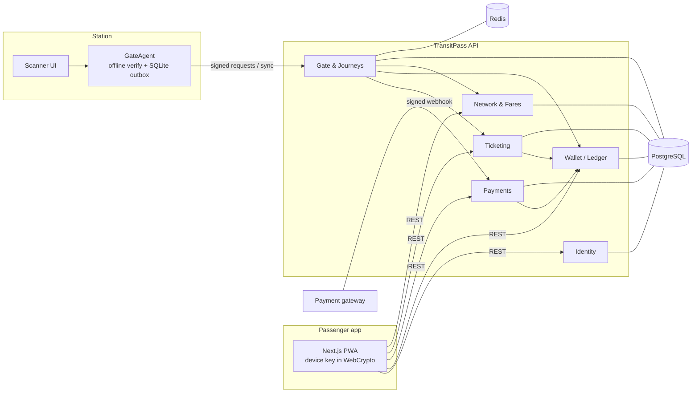
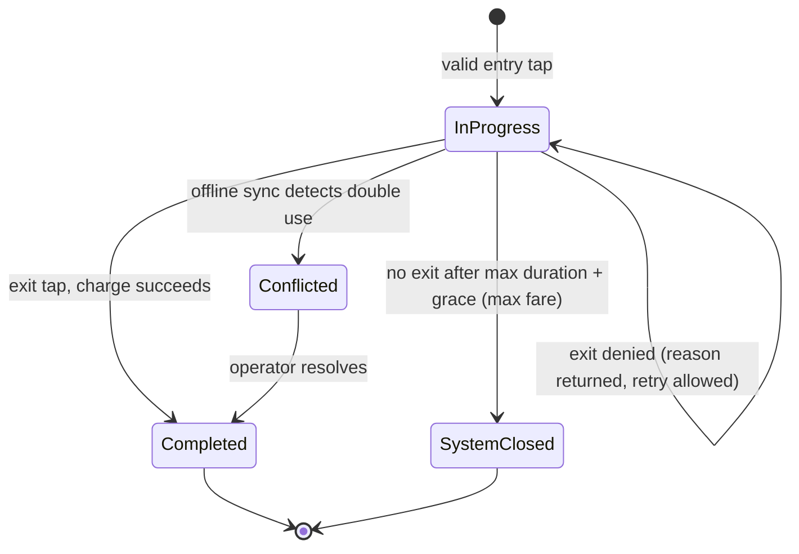
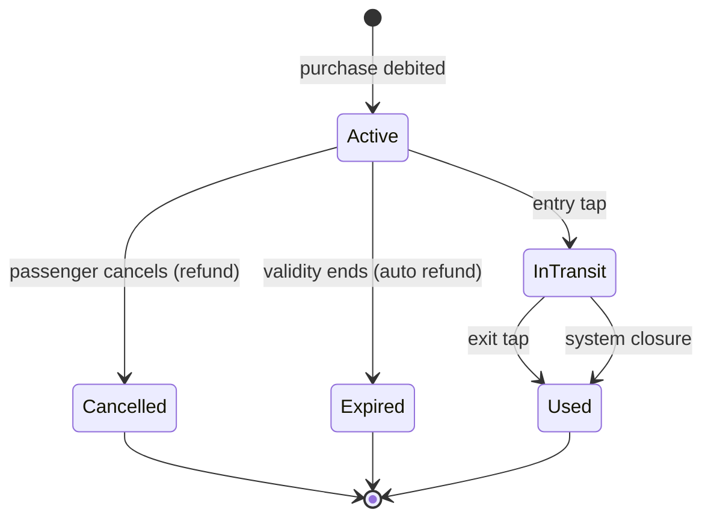
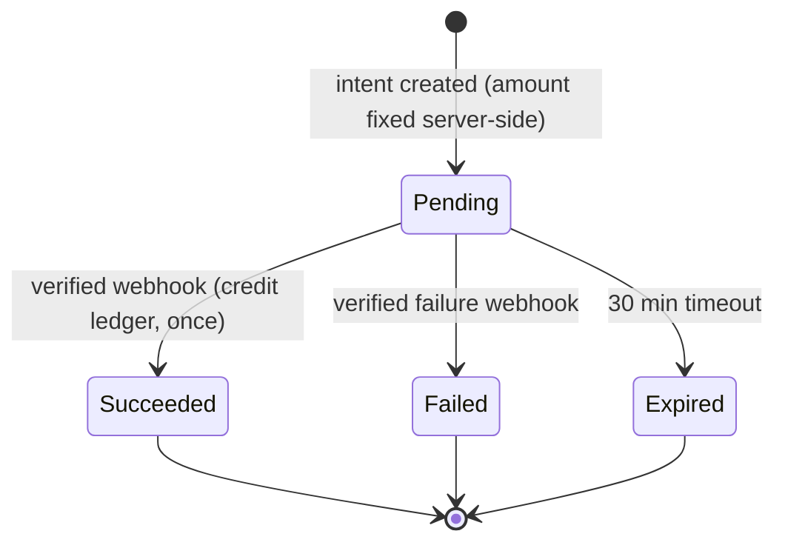

# TransitPass — Product Requirements Document

| | |
|---|---|
| **Status** | Approved for MVP |
| **Owner** | Istiak Ahmed |
| **Last updated** | 2026-11-04 |
| **Related** | [Architecture Decision Records](adr/README.md) |

---

## 1. Summary

TransitPass lets metro passengers enter and exit station gates with their phone: no queue at the ticket
counter, no paper ticket, no cash. It has two products:

- **Single Journey ticket.** Buy a fixed A→B trip in the app, scan to enter at A, scan to exit at B.
- **Stored Value pass.** Tap in at any station, tap out at any station, and the fare is charged from the wallet after the trip.

The design target is that the gate **keeps working when the network does not**, **never charges a passenger twice
or lets a passenger ride free**, and **always leaves a passenger a way out of the station**.

## 2. Problem

Dhaka Metro Rail carries hundreds of thousands of trips per day. Today a passenger without a card must queue at a
counter or a vending machine for a single-trip token.

An earlier QR-ticketing attempt ([netninjas](https://github.com/Learnathon-By-Geeky-Solutions/netninjas)) proved
that the user flow works, but an audit found failures that rule it out for real money:

| # | Failure found | Impact |
|---|---|---|
| P1 | Payment confirmation can be replayed, and the client chooses the payment method | Unlimited free wallet balance and free tickets |
| P2 | Wallet debits use read-modify-write with no concurrency control | Concurrent purchases double-spend one balance |
| P3 | The scanner endpoint is unauthenticated and the station ID comes from the client | Anyone can open or close journeys at any station and drain other wallets |
| P4 | QR codes are static and valid for 24 hours | One screenshot can be shared, and the owner pays for every use |
| P5 | Every scan needs the server | A network outage closes the station |
| P6 | Insufficient balance or an overstay at exit has no resolution path | The passenger is physically stuck behind the gate |
| P7 | No expiry processing, no refunds, no audit trail | Money and tickets drift into undefined states |
| P8 | No tests, and the CI pipeline never ran | None of the above would have been caught |

TransitPass is a redesign that treats P1–P8 as requirements, not bugs.

## 3. Goals and non-goals

### Goals (MVP)
1. **G1. Correct money.** Every taka is accounted for in a double-entry ledger, and balances cannot be corrupted by concurrency or retries.
2. **G2. Unshareable credentials.** A copied QR code is useless within 30 seconds.
3. **G3. Offline-tolerant gates.** Gates validate passengers without the backend and reconcile when it returns.
4. **G4. No stuck passengers.** Every exit attempt ends in either "open" or a deny reason the passenger can act on from the app.
5. **G5. Evidence of correctness.** Invariants are covered by automated tests, including concurrency tests, on every PR.

### Non-goals (MVP)
- A real payment gateway (bKash, SSLCommerz). A simulated gateway implements the **real webhook contract**, so the adapter can be swapped later.
- Real SMS delivery. OTPs go through an `ISmsSender` abstraction with a development sink.
- Group tickets, fare capping, concessions, monthly passes, multi-language UI. The architecture leaves seams for each (§11).
- Physical gate hardware integration. A browser-based scanner stands in for the gate's camera.
- Horizontal autoscaling infrastructure (Kubernetes). The app is stateless and container-ready.

## 4. Personas

| Persona | Needs | Pain today |
|---|---|---|
| **Daily commuter** (Rafi, 28, office worker) | Tap and go in under 2 seconds, predictable charges, clear trip history | Queues in peak hours, unsure what was charged |
| **Occasional rider** (Nusrat, 45, visits family monthly) | Buy one trip without managing a balance, a refund if plans change | Has to learn the counter process every time |
| **Station operator** | Know gates are healthy, resolve passenger disputes | No view into gate state or why a passenger was denied |
| **Network admin** | Manage stations, lines and fares, with an audit trail of who changed what | Fare changes are untracked |

## 5. Key user journeys

### J1. Register and verify
Phone number + password → OTP by SMS → verified account with an empty wallet.

### J2. Top up the wallet
Choose amount → redirect to the gateway → the gateway calls our webhook → wallet credited **once**.
Closing the browser mid-payment must not lose or duplicate money.

### J3. Buy a Single Journey ticket
Choose origin and destination → see the fare → pay from the wallet → the ticket appears with a live QR.
Double-tapping "Buy" creates **one** ticket.

### J4. Ride with a Single Journey ticket
Show the live QR at the origin gate → open → ride → show it at the destination gate → open. The ticket is now used.

### J5. Ride with Stored Value
Tap in at any station (requires at least the minimum fare in the wallet) → ride → tap out anywhere → the fare is charged.

### J6. Exit problems (G4)
| Situation | Outcome |
|---|---|
| Fare exceeds balance, but the result stays within the overdraft limit | Gate opens; the wallet goes negative; the next entry is blocked until top-up |
| Fare exceeds balance and the overdraft limit | Gate denies with `INSUFFICIENT_FUNDS`; the app shows the amount needed and a one-tap top-up; retry opens |
| Single Journey ticket, exit at a farther station | Difference charged from the wallet (same overdraft rules); gate opens |
| Single Journey ticket, exit at a nearer station | Gate opens, no refund (standard metro practice) |
| Trip longer than the maximum duration | Overstay penalty added to the exit charge |

### J7. Cancel and refund
An unused Single Journey ticket can be cancelled before entry for a full wallet refund. An unused ticket that expires is refunded automatically.

### J8. Operator and admin
Enroll a gate device for a station, revoke a device, view taps and denials, manage the network and versioned fares. Every admin change is audited.

## 6. Functional requirements

Priority: **M** = must for MVP, **S** = should, **L** = later.

### Identity (IDN)
| ID | Requirement | P |
|---|---|---|
| IDN-1 | Register with Bangladeshi mobile number (E.164) and password; account inactive until OTP verified | M |
| IDN-2 | OTP: 6 digits, 5-minute TTL, max 5 attempts, 60-second resend cooldown, stored hashed | M |
| IDN-3 | Login returns a 15-minute access token and a rotating refresh token; reuse of a rotated refresh token revokes the whole session family | M |
| IDN-4 | Password change or reset revokes all sessions | M |
| IDN-5 | Rate limiting per phone number and per IP on register, login, OTP, and reset; responses do not reveal whether an account exists | M |
| IDN-6 | Roles: `Passenger`, `Operator`, `Admin`; admin is seeded from configuration only | M |

### Wallet (WAL)
| ID | Requirement | P |
|---|---|---|
| WAL-1 | Each passenger has one wallet account in a double-entry ledger | M |
| WAL-2 | Balance cannot be corrupted by concurrent operations (proved by concurrency tests) | M |
| WAL-3 | Debits respect a configurable floor (0 for purchases and entry, `-overdraft` for exit charges) | M |
| WAL-4 | Paginated transaction history with type, amount, reference and timestamp | M |
| WAL-5 | Ledger entries are immutable; corrections are reversal entries | M |

### Payments (PAY)
| ID | Requirement | P |
|---|---|---|
| PAY-1 | Top-up amount 20–10,000 BDT; a top-up intent is created server-side with a fixed amount | M |
| PAY-2 | The wallet is credited **only** by a signature-verified gateway webhook, never by a browser redirect | M |
| PAY-3 | Duplicate webhooks have no additional effect | M |
| PAY-4 | Intents not completed within 30 minutes expire | M |
| PAY-5 | Daily reconciliation report comparing gateway records with the ledger | S |

### Network & fares (NET)
| ID | Requirement | P |
|---|---|---|
| NET-1 | Admin manages lines, stations (with status), and inter-station distances as a graph; supports interchanges | M |
| NET-2 | Fare = f(shortest network distance) under a **versioned** fare schedule (distance slabs, min, max) with an effective-from time | M |
| NET-3 | Public fare quote endpoint | M |
| NET-4 | A missing route is an explicit error, never a silent default fare | M |
| NET-5 | Closed stations cannot be used as origin or destination for new tickets | M |

### Ticketing (TKT)
| ID | Requirement | P |
|---|---|---|
| TKT-1 | Buy a Single Journey ticket; the fare is snapshotted at purchase; the request is idempotent (`Idempotency-Key`) | M |
| TKT-2 | Ticket validity window: 24 hours (configurable) | M |
| TKT-3 | Cancel before entry → full refund; expire unused → automatic refund | M |
| TKT-4 | Stored Value pass: one per passenger, usable while the account is in good standing | M |
| TKT-5 | Each credential is cryptographically bound to one registered device; re-binding to a new device revokes old credentials | M |
| TKT-6 | The app renders a QR frame that rotates every 15 seconds | M |

### Gate (GTE)
| ID | Requirement | P |
|---|---|---|
| GTE-1 | Gate devices are enrolled by an operator for one station, and authenticate every request with a device key | M |
| GTE-2 | The station of a tap is derived from the device, never from the request | M |
| GTE-3 | A tap is accepted only if the server signature, device signature, time window, and replay checks all pass | M |
| GTE-4 | Journey state machine (§9.2) with exactly-once processing per tap ID | M |
| GTE-5 | Exit resolution policy per J6, with machine-readable deny reasons | M |
| GTE-6 | Offline mode: the gate validates locally, stores taps durably, and syncs idempotently when back online | M |
| GTE-7 | Conflicts found at sync time (offline double use) are flagged for operator review | M |
| GTE-8 | An entry tap with no exit after the maximum duration plus grace is closed by the system at maximum fare | M |
| GTE-9 | Gate health view: last seen, online/offline, sync backlog | S |

### Admin & audit (ADM)
| ID | Requirement | P |
|---|---|---|
| ADM-1 | Every change to network, fares, settings, and devices is audited (actor, time, before/after) | M |
| ADM-2 | Operator can look up a passenger's recent taps and denials | S |

## 7. Non-functional requirements

Capacity assumptions (design inputs, not measured data): **400,000 trips/day**, 20% in the peak hour
→ about 80,000 trips/hour → **about 45 taps/second** at peak. Design target: **10× headroom = 500 taps/second** on the online path.

| ID | Category | Requirement |
|---|---|---|
| NFR-1 | Latency | Online tap decision p99 ≤ **300 ms** server-side; offline local decision p99 ≤ **100 ms** |
| NFR-2 | Throughput | ≥ 500 taps/s sustained on one API instance + one PostgreSQL instance (measured with k6, results in README) |
| NFR-3 | Availability | Gate service is independent of backend availability (offline mode). API target 99.9% |
| NFR-4 | Consistency | Ledger invariants hold under any interleaving of concurrent requests, retries, and duplicate deliveries |
| NFR-5 | Durability | No accepted tap is lost: offline taps persist on the device before the gate opens |
| NFR-6 | Security | OWASP ASVS L2 controls for auth/session; secrets never in the repo; least-privilege tokens |
| NFR-7 | Privacy | Collect only phone, name, and password. No national ID |
| NFR-8 | Observability | Structured logs with correlation IDs, traces, and metrics for tap latency, deny reasons, outbox lag, and sync backlog |
| NFR-9 | Testability | Time is injected (`TimeProvider`); integration tests run against real PostgreSQL |
| NFR-10 | Operability | One-command local stack (Docker Compose); liveness and readiness probes |

## 8. System invariants

These are the properties that must never break. Each one maps to automated tests.

| # | Invariant | Mechanism |
|---|---|---|
| I1 | For every ledger transaction, the sum of its entries is zero | Entries written as a balanced set in one DB transaction; DB check in tests |
| I2 | A wallet balance never goes below its floor | Single-statement conditional `UPDATE … WHERE balance - x >= floor` |
| I3 | Each external event (request key, webhook, tap) has its effect at most once | Unique constraints + idempotency records |
| I4 | A Single Journey ticket opens at most one entry and one exit (online) | Row lock on the ticket during the state transition |
| I5 | A QR frame is valid for at most 30 seconds and only on the bound device | ES256 server signature + device signature over timestamp |
| I6 | Every journey ends in a terminal state | Exit tap, or system closure (GTE-8) |
| I7 | A passenger is never denied exit without a reason they can act on | Exit resolution policy returns typed reasons |

## 9. Domain model

### 9.1 Context map

### 9.2 Journey state machine

### 9.3 Single Journey ticket lifecycle

### 9.4 Top-up intent lifecycle

All transitions are guarded by a conditional update on the current state (`WHERE status = 'Pending'`).
A late success webhook for an `Expired` intent is credited and flagged for reconciliation, never dropped,
because the passenger's money has really moved.

## 10. Threat model (summary)

| Threat | Example | Control | ADR |
|---|---|---|---|
| Credential sharing | Screenshot forwarded to a friend | 15-second rotating frames signed by a device-bound key; 30-second acceptance window; replay rejection | [0007](adr/0007-rotating-device-bound-credentials.md) |
| Credential forgery | Crafted QR payload | ES256 server signature; gates hold only public keys | [0007](adr/0007-rotating-device-bound-credentials.md) |
| Rogue gate | Script calling the tap API as a fake station | Enrolled device keys, signed requests, station derived server-side | [0008](adr/0008-gate-device-authentication.md) |
| Payment spoofing | Forged "payment success" | Only HMAC-verified webhooks credit wallets; amount fixed server-side and matched | [0006](adr/0006-idempotency.md) |
| Replay / double submit | Retried purchase, duplicate webhook | Idempotency keys, unique constraints, state-guarded transitions | [0006](adr/0006-idempotency.md) |
| Account takeover | Brute-force login, stolen refresh token | Rate limits, refresh rotation with reuse detection, session revocation | [0011](adr/0011-identity-and-sessions.md) |
| Offline abuse | Same ticket at two offline gates | Bounded by the frame window; detected at sync; account flagged | [0009](adr/0009-online-first-offline-fallback-gates.md) |
| Enumeration / IDOR | Guessing ticket IDs | UUIDv7 identifiers + ownership checks on every query | [0015](adr/0015-data-conventions.md) |
| Information leakage | Stack traces in responses | RFC 9457 problem details with stable codes; details only in logs | [0014](adr/0014-api-style.md) |

## 11. Scope

### In the MVP
Identity · Wallet ledger · Top-up with a simulated gateway (real webhook contract) · Network & versioned fares ·
Single Journey tickets · Stored Value pass · Rotating device-bound QR · Gate device auth · Online taps ·
GateAgent offline mode + sync · Exit resolution · Expiry, refunds, and system closure jobs · Audit log ·
Next.js passenger PWA + scanner UI · Docker Compose · CI with concurrency tests · k6 load results.

### Designed for, built later
| Feature | Seam that already exists |
|---|---|
| Real bKash / SSLCommerz | `IPaymentGateway` adapter + webhook contract |
| SMS / push notifications | Outbox integration events (`JourneyCompleted`, `WalletDebited`) |
| Fare capping, concessions | `IFarePolicy` strategy evaluated per journey |
| Group tickets | Ticket purchase takes a quantity; one ledger transaction, N credentials |
| Family wallet transfers | Ledger transfers already lock accounts in ascending ID order |
| Extract a microservice | Module `Contracts` + outbox events become the API and broker messages |

## 12. Success metrics

| Metric | MVP target | How measured |
|---|---|---|
| Ledger invariant violations | 0 | Concurrency test suite + reconciliation query |
| Online tap p99 | ≤ 300 ms at 500 taps/s | k6 run, published in README |
| Offline tap durability | 0 lost taps in kill-and-restart test | GateAgent integration test |
| Exit denials without an actionable reason | 0 | Policy unit tests over all reason codes |
| Test coverage of domain + application layers | ≥ 80% lines | CI coverage report |

## 13. Delivery plan

Each step is one PR with CI green before merge. Details live in the PR descriptions.

| # | PR | Delivers |
|---|---|---|
| 1 | Bootstrap ✅ | Solution, conventions, CI, ADR 0001–0004 |
| 2 | PRD + ADRs | This document, ADR 0005–0018 |
| 3 | Building blocks | Result/errors, problem details, `TimeProvider`, PostgreSQL, readiness, idempotency, outbox, architecture tests |
| 4 | Identity | IDN-1…6 |
| 5 | Network & fares | NET-1…5, ADM-1 |
| 6 | Wallet ledger | WAL-1…5, concurrency tests |
| 7 | Payments | PAY-1…4 |
| 8 | Ticketing + credentials | TKT-1…6 |
| 9 | Gate & journeys | GTE-1…5, GTE-8 |
| 10 | Background processing | Expiry, refunds, system closure, outbox dispatch |
| 11 | GateAgent | GTE-6, GTE-7 |
| 12 | Observability & hardening | NFR-8, rate-limit tuning |
| 13 | Passenger PWA | J1–J7 in the browser |
| 14 | Scanner UI | Gate camera flow against the GateAgent |
| 15 | Compose + load test | NFR-2 evidence |
| 16 | README | Final documentation |

## 14. Risks and open questions

| Risk / question | Mitigation / decision |
|---|---|
| WebCrypto non-extractable keys can be cleared by the browser (storage eviction) | `navigator.storage.persist()`; if the key is lost, re-bind via an OTP-confirmed flow that revokes old credentials |
| Gate clock drift breaks the 30-second window | Gates sync NTP; ±5 s future skew tolerated; drift is reported in the health view |
| Offline double use of a Single Journey ticket | Accepted bounded risk (≤ 30 s window × number of offline gates); detected and flagged at sync ([ADR 0009](adr/0009-online-first-offline-fallback-gates.md)) |
| Hot-row contention on system ledger accounts at peak | System accounts carry no balance projection; their balance is derived ([ADR 0005](adr/0005-money-and-double-entry-ledger.md)) |
| Fare slabs for the seed network | Seed data uses min 20 BDT / max 100 BDT bands as an illustrative assumption; admins edit the schedule |

## 15. Glossary

| Term | Meaning |
|---|---|
| **Credential** | Server-signed document proving entitlement to travel, bound to a device public key |
| **Frame** | What the QR shows at an instant: credential + timestamp + device signature |
| **Single Journey (SJ)** | Prepaid ticket for a fixed origin→destination |
| **Stored Value (SV)** | Pass charged per journey from the wallet after exit |
| **Tap** | One gate validation event (entry or exit) with a client-generated ID |
| **Overdraft limit** | How far an exit charge may take the wallet below zero |
| **GateAgent** | Station-side service that validates frames and buffers taps |
